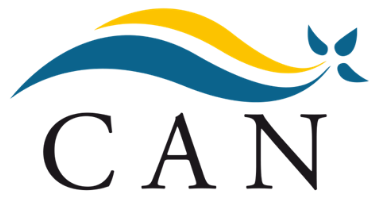
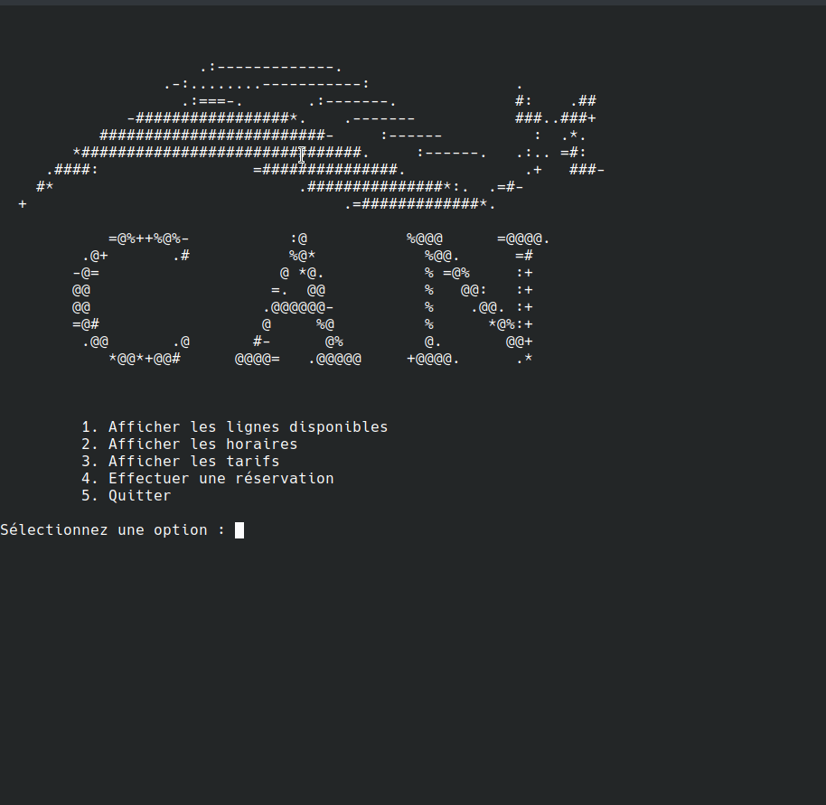
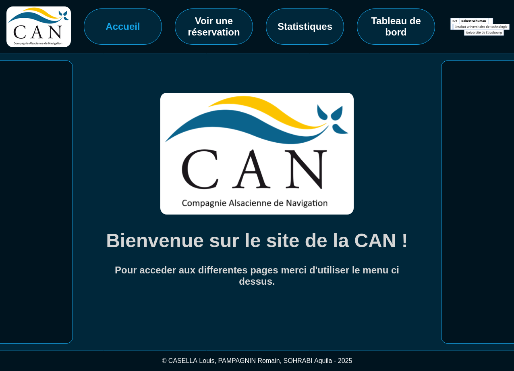
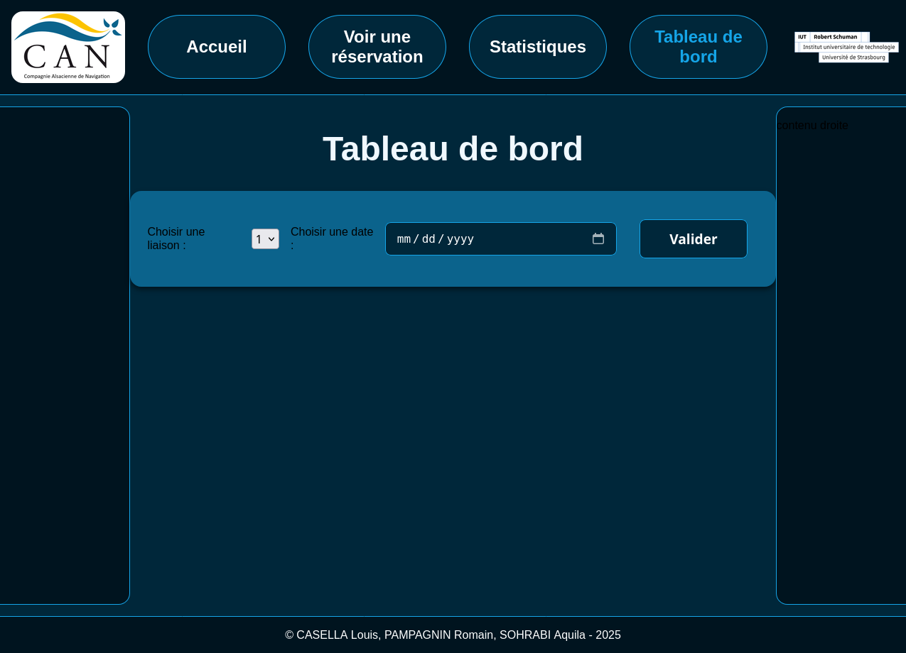
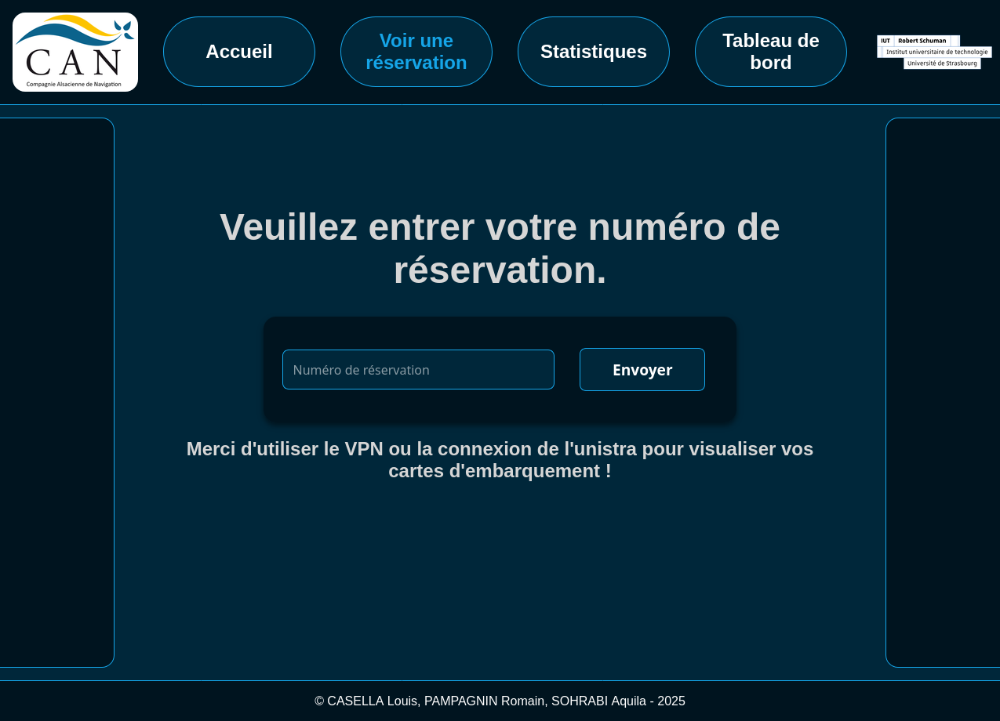

<p align="center"></p>

# PONAN ARCHIPELAGO FERRY BOOKING

> *Un projet de réservation de traversées en ferry entre les îles du Ponan, pour la compagnie fictive CAN (Compagnie Alsacienne de Navigation). <br>La réservation se fait via un programme en C# et une interface console basique, qui exporte les données dans un fichier JSON. <br>Un site web permet l'affichage des billets et de diverses statistiques sur les trajets, à partir d'appels à une API et du fichier JSON hébergé en ligne.*

---
## Présentation du projet

**Ponan Archipelago Ferry Booking** est une SAE effectuée lors du premier semestre de ma première année de BUT informatique. 
<br>Les objectifs pédagogiques étaient :
- appliquer les notions de base d'algorithmique vues pendant le semestre
- manipuler les structures de données
- appliquer les notions de web enseignées pendant le semestre
- découvrir le travail en groupe et la gestion d'un projet informatique

<br>

| Contraites             |                                                                                                                      |
|------------------------|----------------------------------------------------------------------------------------------------------------------|
| Durée de développement | 10 semaines, de novembre 2025 à janvier 2026 *(en parallèle des cours, TD et TP)*                                    |
| Taille de l'équipe     | <a href="https://github.com/louiscasella">Louis</a> <br> <a href="https://github.com/Aqiut">Aquila</a> <br> moi-même |
| Technologies utilisées | langages : C#, HTML, CSS, JavaScript <br>outils : GitHub, Visual Studio Code                                         |

<br>

<p align="center"></p>

---
## Description des fonctionnalités


### Réservation du trajet 

Une application C# permet différentes actions de consultation des informations relatives aux trajets (prix, horaires, lignes desservies), ainsi que la réservation d'un trajet. Toutes les saisies sont blindées (navigation, saisie des informations des passagers).

### Export JSON

A l'issue de la réservation d'un trajet (aller simple ou aller-retour), l'application C# crée un fichier JSON qui compile toutes les informations sur la traversée, les passagers et véhicules éventuels. Le fichier JSON devait ensuite être envoyé vers un dépôt en ligne mis en place par les enseignants, pour être accessible à des requêtes API effectuées par le site web que nous devions développer.
```json
[
  {
      "reservation": {
         "nom": "Groupe_Casa",
         "idLiaison": 3,
         "date": "2025-11-08",
         "heure": "09:45",
         "horodatage": "2026-10-15 14:46:00"
          },
      "passagers": [
      {
             "nom": "Casa",
             "prenom": "Marc",
             "codeCategorie": "adu26p"
      },
      {
             "nom": "Dupont",
             "prenom": "Jacques",
             "codeCategorie": "enf417"
      },
      {
             "nom": "Animal",
             "prenom": "Titi",
             "codeCategorie": "ancomp"
      }
     ],
      "vehicules": [
      {
             "codeCategorie": "trot",
             "quantite": 1
      },
      {
             "codeCategorie": "velo",
             "quantite": 2
      }
     ]
  }
]
```

### Consultation des billets

Le site web permet de visualiser une réservation via l'envoi d'une requête vers le dépôt.

<details>
<summary>Captures d'écran du site internet</summary>

<p align="center"></p>
<p align="center"></p>
<p align="center"></p>

</details>
<br>

Le site internet était hébergé directement sur nos machines, et effectuait des requêtes auprès d'une API mise en place par nos professeurs, qui permettait de consulter toutes les réservations créées par les élèves.
On pouvait alors consulter en détail les passagers et les véhicules appartenant à une réservation. Une partie comptable affichait le détail du tarif de la réservation.

---

## Installer le programme


La partie C# a été développée pour Linux. <br>
Sous Linux :

- cloner le dépôt dans un terminal : `git clone https://github.com/Romain-Pampagnin/Ponan-archipelago-ferry-booking.git`
- se déplacer dans le répertoire : `cd Ponan-archipelago-ferry-booking/progC#`
- donner les droits d'exécution : `chmod 755 test.exe`
- lancer le programme : `./test.exe`

Les enseignants ayant suspendu l'hébergement des fichiers JSON et l'API permettant de les interroger, la partie Web n'est plus fonctionnelle.

---

## Architecture du projet

```
.
├── assets
│   ├── logo_CAN.png
│   ├── reservation.gif
│   ├── screenshot_C#_horaires.png
│   ├── screenshot_C#_menu.png
│   ├── screenshot_json.png
│   ├── screenshot_web_reservation.png
│   ├── screenshot_website_CAN.png
│   └── screenshot_web_tableau_bord.png
├── cours_iut_sae11.code-workspace
├── exports                                     # dossier où sont exportés les fichiers JSON après confirmation d'une réservation
│   ├── Groupe_Casella_2026-01-11 17:11:33.json
│   ├── Groupe_Casella_2026-01-11 18:10:36.json
│   ├── Groupe_Casella_2026-01-12 11:58:39.json
│   ├── Groupe_Pa_2026-01-12 10:37:46.json
│   ├── Groupe_Pa_2026-01-12 11:16:19.json
│   └── Groupe_Pa_2026-01-12 16:58:42.json
├── LICENSE
├── progC#                                      # code C# de l'application de réservation
│   ├── exemple.json
│   ├── repartition_taches.txt
│   ├── SAE11.code-workspace
│   ├── test.cs
│   ├── test.exe                                # programme fonctionnel et abouti
│   ├── testExportJson.cs
│   ├── testExportJson.exe                      # version de test
│   ├── testImageMenu.cs
│   ├── testImageMenu.exe                       # version de test
│   ├── testSaisieBlindee.cs
│   └── testSaisieBlindee.exe                   # version de test
├── progWEB                                     # site internet
│   ├── boarding.html
│   ├── css
│   │   ├── normalize.css
│   │   └── style.css
│   ├── facture.html
│   ├── img
│   │   └── logo.png
│   ├── index.html
│   ├── js
│   │   └── script.js
│   ├── stats.html
│   └── tableau.html
├── README.md
└── ressources                                  # fichiers CSV utilisés pour le stockage des horaires, des prix
    ├── CAN.png
    ├── catVehicules.csv
    ├── GroixLorientNov25.csv
    ├── imgMenu.txt
    ├── LePalaisQuiberonNov25.csv
    ├── LorientGroixNov25.csv
    ├── QuiberonLePalaisNov25.csv
    ├── tarifsBelleIle.csv
    └── tarifsGroix.csv

```

---
## Retour d'expérience

A titre personnel, ce projet m'a permis de mettre en pratique mes connaissances très incomplètes du C# et de l'algorithmique, au sein d'un travail en équipe pas toujours simple à gérer. Il s'agissait de mon tout premier projet informatique. <br>
C'était aussi notre première utilisation de GitHub, qui nous a permis d'aborder en surface les problématiques de versionnage et de travail sur plusieurs branches.<br>
Concernant les tâches que j'ai accomplies, j'ai beaucoup apprécié la phase de conception où il a fallu décider de l'implémentation des différentes structures de données, et de l'architecture globale du programme en C#. Voir le projet évoluer et gagner petit à petit en fonctionnalités était très stimulant et source de satisfaction.<br>
A distance du projet (octobre 2026), je constate ma propre progression en programmation et en compréhension des besoins et fonctionnalités. Ce projet est très perfectible, mais je considère que c'est un bon point de départ, et une première étape dans ma formation et mon apprentissage.

---
## Crédits et licence

- Romain : partie C#
- <a href="https://github.com/louiscasella">Louis</a> et <a href="https://github.com/Aqiut">Aquila</a> : partie Web
- IUT Robert Schuman, département informatique : encadrement, sujet, conseils

<br>
Licence MIT, voir le fichier LICENSE